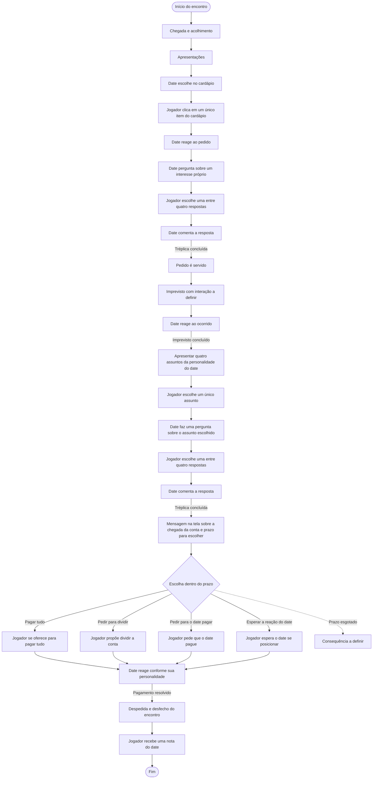

# Fluxo básico de interação do encontro

**Status:** fluxo base consolidado, com pendências específicas de implementação e apresentação listadas ao final.

Este documento define o padrão comum a todos os agentes de *Worst Date Ever*. Cada personagem mantém sua personalidade, seu local de encontro, seus interesses e suas reações, seguindo as mesmas etapas principais.

## Contexto anterior ao encontro

Antes deste fluxo, o jogador está em casa, escolhe o date pelo celular e decide se vai consumir alguma substância ou permanecer sóbrio. Em seguida, vai ao local do encontro. Essas escolhas estabelecem o contexto da experiência.

## Fluxograma base

As caixas de ação representam estados do encontro. O avanço depende da conclusão das interações previstas. O diagrama mostra o percurso com imprevisto; a regra de ocorrência dos eventos fica na seção de opcionais. O ramo tracejado registra uma pendência: a consequência de não escolher o pagamento dentro do prazo.

## Etapas e transições

| Estado | Interação básica | Acontecimento que permite avançar |
| --- | --- | --- |
| Chegada e acolhimento | O date recebe o jogador no local. | Acolhimento concluído. |
| Apresentações | Os dois se apresentam. | Apresentações concluídas. |
| Pedido do date | O date escolhe no cardápio. | Pedido do date definido. |
| Pedido do jogador | O jogador clica em um único item do cardápio. | Item selecionado; o pedido fica definido. |
| Reação ao pedido | O date comenta a escolha conforme sua personalidade. | Reação concluída. |
| Pergunta inicial | Enquanto aguardam o pedido, o date pergunta sobre um de seus interesses. | Pergunta apresentada e quatro respostas disponíveis. |
| Réplica inicial | O jogador seleciona uma das quatro respostas. | Resposta selecionada. |
| Tréplica inicial | O date comenta a resposta conforme sua personalidade. | Comentário concluído; o assunto termina. |
| Serviço | O pedido é servido. | Entrega do pedido concluída. |
| Imprevisto | Um acontecimento interfere no encontro e o date reage. A participação do jogador ainda será definida. | Imprevisto concluído; o critério específico permanece em aberto. |
| Escolha de assunto | O jogador recebe quatro temas ligados à personalidade do date e escolhe um. | Assunto selecionado. |
| Pergunta sobre o assunto | O date faz uma pergunta sobre o tema escolhido. | Pergunta apresentada e quatro respostas disponíveis. |
| Réplica sobre o assunto | O jogador seleciona uma das quatro respostas. | Resposta selecionada. |
| Tréplica sobre o assunto | O date comenta a resposta conforme sua personalidade e o contexto do encontro. | Comentário concluído; o assunto termina e o fluxo segue para a conta. |
| Chegada da conta | Uma mensagem na tela avisa sobre a conta e solicita uma escolha rápida entre quatro opções. | Mensagem e opções disponíveis; começa o prazo de escolha. |
| Escolha de pagamento | O jogador seleciona uma das quatro opções dentro do prazo. | Opção selecionada; a consequência do prazo esgotado ainda será definida. |
| Reação ao pagamento | O date reage à opção conforme sua personalidade. | Pagamento resolvido; o tratamento de discordâncias ainda será definido. |
| Despedida | Os dois se despedem e o encontro tem seu desfecho. | Despedida concluída. |
| Nota final | O jogador recebe uma nota do date. | Nota apresentada; encerra-se a experiência. |

## Pedido no cardápio

O jogador faz **um único pedido por clique**, selecionando uma das opções do cardápio. O item é comida ou bebida, conforme o cenário. Os itens disponíveis em cada local ficam fora do detalhamento deste fluxo comum.

Depois da escolha, o jogador não pode alterar, completar ou fazer outro pedido nessa partida. O date reage à seleção e o encontro segue para a conversa inicial.

## Formato das conversas

Cada pergunta apresenta **exatamente quatro opções de resposta**. O jogador escolhe uma delas. A resposta livre por voz fica como melhoria opcional.

Cada assunto tem uma pergunta, uma réplica e uma tréplica:

1. O date faz uma pergunta.
2. O jogador seleciona uma resposta: a réplica.
3. O date responde à resposta do jogador, expressando sua opinião ou reação: a tréplica.

**Concluída a tréplica, o assunto termina e o encontro avança.** Não há novas rodadas dentro daquele assunto. Esse é o critério de conclusão dos dois blocos de conversa.

### Primeiro bloco: iniciativa do date

Depois de reagir ao pedido, o date puxa uma conversa sobre **um interesse próprio**, enquanto os dois aguardam. O assunto depende de sua personalidade; não há um tópico obrigatório comum a todos.

O jogador escolhe uma das quatro respostas e o date dá a tréplica. O assunto termina e o fluxo segue para o serviço do pedido.

### Segundo bloco: iniciativa do jogador

Depois do imprevisto e da reação do date, o jogo apresenta **quatro opções de assunto**, todas apoiadas em interesses, gostos ou informações definidos na personalidade da pessoa com quem o jogador está conversando.

O jogador escolhe **um único tema**. O date faz uma pergunta sobre ele; o jogador seleciona uma entre quatro respostas e o date dá a tréplica. A escolha do assunto e a escolha da resposta são momentos distintos.

Ao final dessa troca, o fluxo segue para a conta. O jogador não retorna ao menu de temas. **Para explorar outro assunto, precisa iniciar uma nova partida e repetir o jogo.**

## Progressão por acontecimentos

O encontro funciona como uma máquina de estados: há uma etapa ativa, uma interação a realizar e um acontecimento de conclusão que libera a próxima etapa.

Selecionar um item conclui o pedido; concluir uma tréplica encerra o respectivo assunto; concluir o imprevisto libera o bloco iniciado pelo jogador. A passagem do tempo não substitui essas interações.

**A escolha do pagamento tem um prazo específico.** A seleção de uma opção ou o esgotamento desse prazo são acontecimentos desse estado. Isso não transforma o restante do encontro em uma sequência guiada por tempo. A duração do prazo e sua consequência ainda precisam ser definidas.

As falas e reações devem respeitar a etapa atual e considerar as escolhas anteriores. Um novo assunto não permite pular etapas do encontro.

## Relação com a personalidade

O padrão estabelece a sequência de interações. A personalidade define como o agente participa delas: sua maneira de falar, o assunto que introduz, as quatro opções de tema oferecidas ao jogador, seu pedido e suas reações às respostas, ao imprevisto e ao pagamento.

As informações descobertas e os acontecimentos anteriores permanecem no contexto das falas seguintes. O detalhamento das perguntas, das alternativas e das reações de cada personagem será feito a partir das respectivas personas.

## Imprevisto

O fluxo base mantém a etapa de imprevisto depois do serviço e antes do assunto escolhido pelo jogador. A decisão sobre eventos ocorrerem sempre ou por probabilidade fica registrada na seção de opcionais.

A forma de reação do jogador ao imprevisto permanece em aberto, assim como seu critério específico de conclusão. Essa etapa ainda não determina se haverá opções, ações no ambiente ou outro mecanismo. O ocorrido deve ser considerado pelo date na conversa seguinte.

## Conta e pagamento

Quando a conta chega, aparece uma mensagem na tela, por exemplo: **“A conta está chegando. Escolha rápido!”** O jogador tem um tempo limitado para clicar em uma destas quatro opções:

| Opção | Intenção do jogador |
| --- | --- |
| Pagar tudo | Oferecer-se para pagar a conta inteira. |
| Pedir para dividir | Propor a divisão da conta. |
| Pedir para o date pagar | Pedir que a outra pessoa pague a conta. |
| Esperar a reação do date | Deixar que o date se posicione primeiro. |

A redação se aplica a qualquer date. O personagem reage à opção escolhida conforme sua personalidade e o contexto acumulado do encontro.

“Esperar a reação do date” é uma escolha explícita, selecionada dentro do prazo. O que acontece se o jogador não selecionar nenhuma opção até o tempo acabar ainda não foi definido; não se presume que isso equivale à quarta opção.

## Despedida e nota final

O desfecho acontece no fim do encontro, quando os dois se despedem. Ao final da despedida, **o jogador recebe uma nota do date**.

A escala, os critérios de cálculo e a apresentação visual dessa nota ainda precisam ser definidos. O fluxo registra a entrega da nota, sem fixar sua aparência ou estabelecer um indicador visível de interesse ao longo do encontro.

## Decisões em aberto

1. **Prazo da conta:** quanto tempo o jogador terá para escolher uma das quatro opções?
2. **Prazo esgotado:** o que acontece quando o jogador não escolhe nenhuma opção a tempo?
3. **Discordância no pagamento:** como resolver a conta caso o date rejeite a proposta do jogador, mantendo a sequência até a despedida?
4. **Nota do date:** qual será a escala e quais critérios ou escolhas influenciam seu cálculo?
5. **Apresentação da nota:** como a avaliação aparecerá visualmente ao final da despedida?

A interação com o imprevisto permanece reservada para definição futura na seção correspondente. As perguntas, alternativas e reações específicas pertencem ao detalhamento de cada personagem.

## Melhorias opcionais

### Encerramento antecipado

Como melhoria opcional, o jogador poderá decidir sair no meio do encontro. O date também poderá encerrá-lo antes das próximas etapas caso perca muito interesse no jogador.

Essa possibilidade fica fora do fluxo principal da entrega inicial, considerando o tempo disponível e o escopo de integração. Se for incluída, será necessário definir os estados em que pode acontecer, o critério de perda de interesse e o desfecho correspondente.

### Resposta livre por voz

Como melhoria opcional, o jogador poderá responder livremente por voz às perguntas do date. A viabilidade ainda precisa ser avaliada; por enquanto, cada pergunta oferece quatro respostas selecionáveis.

Se for incluída, será necessário definir como a resposta falada será interpretada e como levará à tréplica do date e à conclusão do estado atual.

### Regra de ocorrência dos eventos

Fica nesta seção a definição de os eventos **ocorrerem sempre ou terem uma probabilidade de ocorrência**, além da escolha do evento, de sua quantidade e da possibilidade de outros momentos para dispará-los.

O diagrama atual representa o percurso com um imprevisto. Se for adotada ocorrência probabilística, será necessário representar também o caminho sem evento, que segue para o assunto escolhido pelo jogador. Essas variações não alteram as regras já definidas para pedido, conversas, pagamento e nota final.
